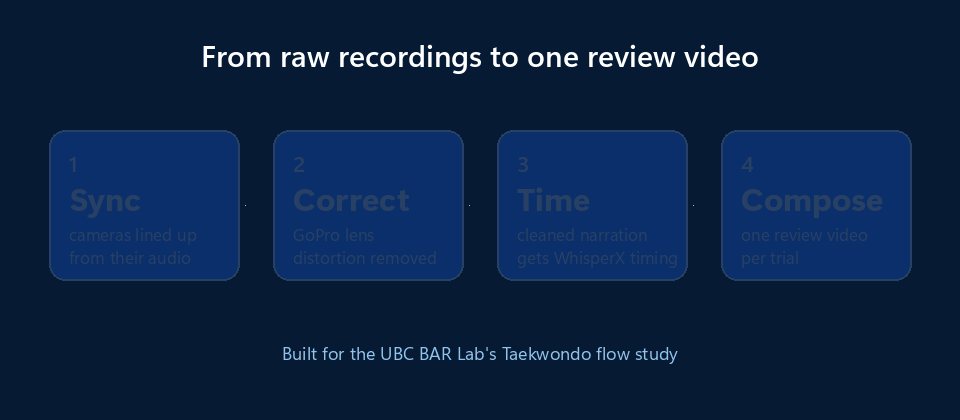

<p align="center">
  <picture>
    <source media="(prefers-color-scheme: dark)" srcset="docs/assets/brand/readme-banner-dark.png">
    <source media="(prefers-color-scheme: light)" srcset="docs/assets/brand/readme-banner-light.png">
    
  </picture>
</p>

<p align="center">
  
  
  
  <a href="LICENSE"></a>
</p>

<p align="center"><b>Turn each trial's cameras, narration and heart rate into one synced, subtitled review video.</b></p>

<p align="center">
  
</p>

<p align="center">
  <a href="#why-it-exists"><b>Why it exists</b></a> ·
  <a href="#status"><b>Status</b></a> ·
  <a href="#quick-start"><b>Quick start</b></a> ·
  <a href="#usage"><b>Usage</b></a> ·
  <a href="#dataset-layout"><b>Dataset layout</b></a> ·
  <a href="docs/MVP_SPEC.md"><b>Specification</b></a> ·
  <a href="#credits"><b>Credits</b></a>
</p>

---

**Who it's for.** Researchers who record athletes with several cameras, heart rate and a narrated
self-review, and need it all lined up before they can code it. FlowAnalytics does the aligning, so
the team reviews one video per trial instead of lining up files by hand. It was built for the
UBC Brain, Attention and Reality Lab's Taekwondo flow study, whose sessions are recorded with
[Iris](https://github.com/CamHickling/Iris).

**What you get**

- **No hand alignment.** Cameras are synced from their audio, with an interactive check when you want one.
- **One review video per trial.** Both GoPro angles (lens-corrected), the face camera, subtitles and live heart rate.
- **Subtitles you can trust.** Your team's cleaned transcript sets the wording; WhisperX, run locally, only supplies the timing.
- **Pauses handled.** When the athlete pauses to talk, the performance freezes while narration, face camera and heart rate keep running.
- **Checked before it scales.** Every step runs on one trial before the batch.

**Track record:** a review video for every one of the study's 60+ trials, and more than 120 hours of manual alignment cut. 48 of 51 narrations matched automatically; 3 went to a person.

## Overview

FlowAnalytics is the processing toolkit behind a flow-state study of taekwondo
poomsae performance. Each trial is recorded by several cameras (front GoPro,
side GoPro, overhead, face cam) alongside a heart-rate monitor, and the athlete
later narrates a review of their own performance.

The toolkit turns those raw recordings into one composed **review video** per trial:

```text
+-----------------------------+------------------------------+
| Front GoPro (undistorted)   | Side GoPro (undistorted)     |
|                             |              +-------------+ |
|                             |              | Face camera | |
|                             |              +-------------+ |
+-----------------------------+------------------------------+
| Subtitles from the athlete's cleaned narration             |
+------------------------------------------------------------+
| Heart-rate graph with moving current-value marker          |
+------------------------------------------------------------+
```

When the athlete pauses playback to talk, the performance footage freezes while
narration, the face cam, subtitles, and heart-rate keep running. See the
[MVP specification](docs/MVP_SPEC.md) for the full design.

### Features

| Stage | What it does | Tool |
| --- | --- | --- |
| **Sync** | Audio-landmark ("constellation") and cross-correlation sync between cameras, plus interactive manual sync | `scripts/cfsync.py`, `scripts/batch_sync.py`, `scripts/sync_review.py` |
| **Calibrate** | Robust OpenCV intrinsic calibration from checkerboard passes across the whole dataset | `scripts/osr_instr_calibrate.py` |
| **Undistort** | Per-camera lens correction of GoPro footage | `scripts/undistort.py` |
| **Transcribe** | Batch WhisperX transcription with resume support | `scripts/process_videos_whisperx.py` |
| **Align subtitles** | Merge human-cleaned narration onto WhisperX timing, flagging mismatches | `scripts/compare_narration_transcripts.py` |
| **Compose** | Staged pipeline: inspect → timing → pause map → chart → prepare → render | `scripts/mvp.py` |
| **Analyze** | Heart-rate analysis, narration segmentation, LLM-assisted coding, inter-rater reliability | `analysis/` |

## Why it exists

**The problem.** Each of the study's 60+ trials, recorded with
[Iris](https://github.com/CamHickling/Iris), produced several camera angles, heart rate and a
narrated review. Turning those into something researchers could code meant aligning every
recording by hand.

| Decision | Why |
| --- | --- |
| People's cleaned transcript decides the wording; WhisperX, run locally, supplies only the timing | Researchers trust their own transcripts, the model is used only where it's reliable, and no audio leaves the lab |
| Where the model's transcript matched the people's, it was accepted; where it didn't, a person reviewed it. Originals are never overwritten | A wrong subtitle in research data is worse than a missing one. Of 51 narrations, 48 matched and 3 went to review |
| Every step is checked on one trial before running the batch | Mistakes are caught once, not 60 times |
| An LLM can code the narration as an extra coder, with its agreement with human coders measured (kappa) before its labels are trusted | AI that adds speed is only used where it's shown to agree with people |

**Impact.** More than 120 hours of manual alignment cut. Every trial gets one review video, with
both camera angles, the face camera, subtitles and live heart rate.

## Quick start

```bash
git clone https://github.com/CamHickling/FlowAnalytics.git
cd FlowAnalytics
python -m venv .venv
.venv\Scripts\activate            # Linux/macOS: source .venv/bin/activate
pip install -r requirements.txt
```

FFmpeg is bundled through `imageio-ffmpeg`, so no separate install is needed for
the core pipeline. Optional extras:

```bash
pip install -r envs/requirements-analysis.txt          # analysis/ scripts
conda env create -f envs/environment-whisperx-gpu.yml  # WhisperX transcription (CUDA)
```

**Check that it worked:** `python scripts/mvp.py --help` lists the pipeline's stages
(`inspect`, `timing`, `pause-map`, `chart`, … `render`).

Point the tools at your dataset:

```powershell
$env:FLOW_ANALYTICS_DATA_ROOT = 'D:\FlowAnalytics\Iris_Recorded_Taekwondo_Data'
```

## Usage

The examples below use PowerShell; the scripts themselves are cross-platform.

```powershell
$trial       = "$env:FLOW_ANALYTICS_DATA_ROOT\P01_20260223_112737"
$calibration = '.\calibration'
```

### 1. Calibrate the cameras (once per camera set)

```powershell
Push-Location $calibration
python ..\scripts\osr_instr_calibrate.py --intrinsics $env:FLOW_ANALYTICS_DATA_ROOT
Pop-Location
```

Writes `front_calibration.json` and `side_calibration.json`. See
[docs/calibration.md](docs/calibration.md) for how the solver rejects blurry
frames and prunes outliers.

### 2. Run the staged MVP pipeline on one trial

Validate each stage on a single trial before running a batch:

```powershell
python scripts\mvp.py inspect   --trial $trial --calibration-dir $calibration   # find inputs, report gaps
python scripts\mvp.py timing    --trial $trial                                  # validate manifest timing
python scripts\mvp.py pause-map --trial $trial                                  # map review pauses
python scripts\mvp.py chart     --trial $trial --at-sec 60                      # heart-rate chart + preview
python scripts\mvp.py prepare   --trial $trial --calibration-dir $calibration --dry-run
python scripts\mvp.py prepare   --trial $trial --calibration-dir $calibration   # undistort front + side
python scripts\mvp.py render-preview --trial $trial --duration 15 `
    --subtitles "$trial\review\narration.srt"                                    # 15 s check clip
```

When the preview looks right, render the full video, or every trial at once:

```powershell
python scripts\mvp.py render --trial $trial
python scripts\mvp.py batch-render --data-root $env:FLOW_ANALYTICS_DATA_ROOT --skip-existing
```

Camera offsets can be suggested automatically (`suggest-offsets`), checked
visually (`verify-offsets`), or recorded from a manually matched moment
(`record-match`, or interactively with `scripts\sync_review.py`). Run
`python scripts\mvp.py <command> --help` for all options.

All intermediates (undistorted video, timing, chart data, subtitle cues) are
kept under `<trial>\MVP\generated\`.

### 3. Build timed subtitles from cleaned narration

The human-cleaned `<trial>_audio_narration.txt` is the **source of truth for
wording**; WhisperX is used only to recover timing.

```powershell
# Recover timing with WhisperX
python scripts\process_videos_whisperx.py "$trial\review" --audio-only `
    --output-dir "$trial\MVP\generated\whisperx" --model large-v3 `
    --device cuda --language en --no-diarize

# Merge cleaned wording onto the timed segments
python scripts\compare_narration_transcripts.py `
    --clean  "$trial\review\P01_audio_narration.txt" `
    --timed  "$trial\MVP\generated\whisperx\P01_audio_narration.srt" `
    --output-dir "$trial\MVP\generated\synthesis"
```

Unmatched lines are marked `needs_review` rather than given guessed timings, and
original files are never overwritten. For whole-dataset transcription, use
`tools\run_whisperx_batch.ps1` (pass `-PythonExe` or set
`FLOW_ANALYTICS_PYTHON`) or `tools\run_whisperx_capture.bat`.

### 4. Research analysis

Scripts in [`analysis/`](analysis) support the study itself:

| Script | Purpose |
| --- | --- |
| `heart_rate_analysis.py` | Full-session HR analysis: resting vs. warm-up baselines, performance ROI |
| `narration_make_units.py` | Segment narration into thought-units for coding |
| `narration_freeze.py` / `narration_promote.py` | Freeze hand-edited segmentation and build coder templates |
| `narration_llm_label.py` | Apply the coding rubric with an LLM as an additional coder (needs `ANTHROPIC_API_KEY`) |
| `narration_kappa.py` | Cohen's, weighted, and Fleiss' kappa plus PABAK across coders |
| `count_playback_events.py` | Summarize playback start/stop events per session |

They read from `FLOW_ANALYTICS_DATA_ROOT`, falling back to
`./Iris_Recorded_Taekwondo_Data`.

## Dataset layout

Each trial folder follows this structure:

```
<data root>/
└── P01_20260223_112737/
    ├── gopro_footage/          front + side GoPro recordings, sync info
    ├── review/                 face cam, narration audio + cleaned transcript, review timestamps
    ├── heart_rate/             HR session CSVs and plots
    ├── P01_sync_manifest.json  event timeline for the session
    └── MVP/                    everything this toolkit generates
```

Participant data is **not** distributed with this repository. Keep the dataset
outside the repo and point `FLOW_ANALYTICS_DATA_ROOT` at it; the data folder
names are also listed in `.gitignore` as a safeguard.

## Project structure

```
FlowAnalytics/
├── scripts/        Core pipeline: sync, calibration, undistortion, transcription, MVP composer
├── analysis/       Research analysis: heart rate, narration coding, inter-rater reliability
├── tools/          Launchers and utilities (WhisperX batch runners, session lister, codepack)
├── experiments/    Early sync prototypes kept for reference
├── tests/          Unit tests
├── calibration/    Camera calibration JSON (archive/ and test/ hold older or trial solves)
├── envs/           Conda environments and optional requirement sets
└── docs/           Specification, calibration notes, project status, task plan, brand assets
```

## Status

FlowAnalytics is a **research prototype**. Each part is marked ✅ working, 🟡 in progress or ⏳ planned.

| Part | Status |
| --- | --- |
| Camera sync (audio landmarks, cross-correlation, manual review) | ✅ Working |
| Narration transcription (WhisperX) and subtitle alignment | ✅ Working: 51 narrations compared, 48 matched, 3 reviewed by a person |
| GoPro lens calibration and undistortion | ✅ Working |
| Composed review video (`scripts/mvp.py`) | ✅ Working: every trial in the study has its review video |
| Analysis: heart rate, narration segmentation, LLM-assisted coding with inter-rater reliability | 🟡 Research scripts |

See [docs/project-status.md](docs/project-status.md) and [docs/tasks.md](docs/tasks.md) for details.

## Testing

```bash
python -m unittest discover -s tests
```


## Contributing

Contributions are welcome. Please read [CONTRIBUTING.md](CONTRIBUTING.md) before
opening a pull request.

## Credits

- **Cam Hickling**: author.
- **Angela Mejia**: co-author of `analysis/heart_rate_analysis.py` and
  `analysis/narration_make_units.py`.
- Built in collaboration with Alan Kingstone, Angela Mejia, Baruch Eitam and the research
  assistants of the UBC Brain, Attention and Reality (BAR) Lab.

## Ethics and data

No participant data, faces, voices or names are in this repository, its images or its GIF.
Recordings stay on the lab's own storage (point `FLOW_ANALYTICS_DATA_ROOT` at them), and
transcription runs locally, so no audio leaves the lab. Getting consent and storing data as your
ethics approval requires is the researcher's responsibility.

## Citation

If you use FlowAnalytics in published research, please cite it. Citation metadata is in
[CITATION.cff](CITATION.cff), and GitHub shows a "Cite this repository" button for it.

## License

Licensed under the [Apache License, Version 2.0](LICENSE). See [NOTICE](NOTICE)
for attribution.

---

<p align="center">
  
  <br>
  <sub>FlowAnalytics · Apache 2.0 · Built for the poomsae flow study</sub>
</p>
